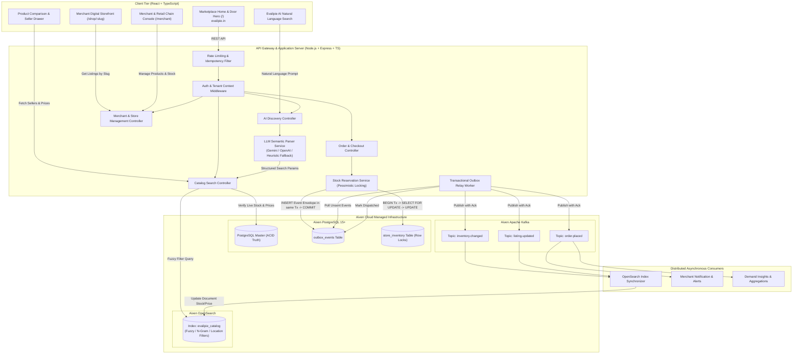
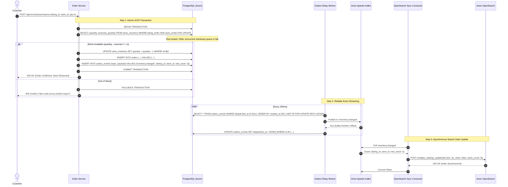
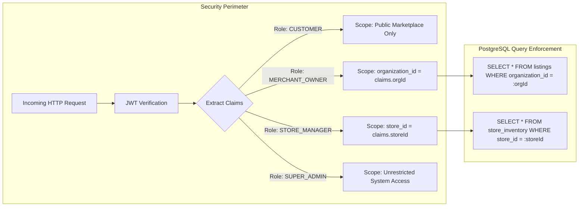

# EVALIPIE — Complete System Architecture Specification

> **Document Status:** Phase 0 — Technical Architecture Blueprint  
> **Target Platform:** React (Vite/TypeScript) + Node.js (Express/TypeScript) + Aiven Cloud (PostgreSQL, Kafka, OpenSearch)

---

## 1. Core Architectural Tenets

1. **PostgreSQL is the Sole Source of Truth:** OpenSearch is an ephemeral, read-optimized search index. Apache Kafka is an asynchronous event distribution backbone. Neither OpenSearch nor Kafka can independently authorize orders or approve stock reservations. All balance, inventory, and order state mutations occur strictly within PostgreSQL ACID transactions.
2. **Zero Overselling via Pessimistic Row Locking:** Checkouts validate and reserve stock using atomic database transactions with row-level locks (`SELECT ... FOR UPDATE`). No two concurrent transactions can claim the same physical inventory unit.
3. **Dual-Write Elimination via Transactional Outbox:** To prevent distributed inconsistencies between PostgreSQL and Kafka/OpenSearch, state changes and event envelopes are written to the database in a single atomic transaction. An independent outbox publisher worker drains this table and pushes to Kafka with at-least-once delivery guarantees.
4. **Catalogue-Grounded AI (Zero Hallucination):** The LLM acts strictly as a semantic translator—converting fuzzy human needs into structured search parameters (categories, budget, tags). The actual catalog search, price display, and stock verification are executed against OpenSearch and PostgreSQL records.
5. **Unified Multi-Tenant Domain:** Single codebase and schema serving both standalone independent merchants and multi-branch retail chains through hierarchical organization and store modeling.

---

## 2. End-to-End System Architecture

---

## 3. Transactional Outbox & Event Streaming Architecture

To guarantee that inventory adjustments and order placements never diverge from the OpenSearch catalog, Evalipie implements the **Transactional Outbox Pattern**:

---

## 4. Frontend Architecture (Client Application)

* **Framework:** React 18+ with TypeScript, bundled with Vite for rapid HMR and optimized tree-shaken builds.
* **Styling & Tokens:** Tailwind CSS with centralized design tokens adhering to the Evalipie aesthetic:
  - Typography: `Plus Jakarta Sans`, `-apple-system`, `sans-serif`
  - Color Palette: Deep Navy (`#111827`), Teal Accent (`#167D73`), Mint (`#E9F7F3`), AI Violet (`#7657E8`), Alert Amber (`#E9A23B`), Error Red (`#DC4444`).
* **State Management:**
  - Client / UI State: Zustand for lightweight, decoupled store management (Cart drawer, User location/city preference, Notification toasts).
  - Server Cache & Revalidation: TanStack Query (React Query) for automatic caching, background polling, and optimistic updates.
* **Core View Hierarchy:**
  1. `DoorHeroView`: Scroll-driven or gesture-based 3D CSS perspective door reveal.
  2. `MarketplaceView`: AI search bar, category chips, trending cards with real-time stock tags, store proximity cards.
  3. `ShopStorefrontView`: Dynamic routing `/shop/:slug` featuring independent shop banner, address, verified badges, and catalog.
  4. `ProductComparisonModal`: Multi-seller comparison drawer listing all merchants selling the active canonical item.
  5. `MerchantConsoleView`: Tabular inventory management with inline stock steppers and order status transitions.

---

## 5. Backend Architecture (API Service)

* **Runtime:** Node.js 20+ with TypeScript (`strict: true`).
* **Framework:** Express.js structured in clean architectural layers:
  - `controllers/`: HTTP request validation, status codes, and JSON response formatting.
  - `services/`: Core business logic (Stock calculation, AI prompt structuring, Order lifecycle).
  - `repositories/`: Direct database queries utilizing parameterized SQL and connection pools.
  - `workers/`: Independent event dispatchers and Kafka consumer threads.
  - `middleware/`:
    - `tenantContext.ts`: Resolves `organization_id` and authorized `store_id` from JWT claims.
    - `idempotency.ts`: Checks Redis/Postgres for repeat request keys to prevent duplicate payments.
    - `rateLimiter.ts`: Sliding-window rate limiter guarding AI and checkout endpoints.

---

## 6. Aiven Infrastructure Integration

### A. Aiven PostgreSQL
* **Role:** Single source of ACID truth.
* **Configuration:** High-availability cluster with PgBouncer connection pooling enabled.
* **Isolation Level:** `READ COMMITTED` by default; explicit `SELECT ... FOR UPDATE` row locking during stock-critical transactions.

### B. Aiven Apache Kafka
* **Role:** Scalable, durable event spine decoupling the synchronous web tier from asynchronous indexers and notification services.
* **Topics Plan:**
  - `evalipie.order.placed` (Partitions: 3, Retention: 7 days) — Keys partitioned by `organization_id`.
  - `evalipie.inventory.changed` (Partitions: 3, Retention: 3 days) — Keys partitioned by `listing_id`.
  - `evalipie.listing.updated` (Partitions: 3, Retention: 3 days) — Keys partitioned by `listing_id`.
* **Idempotent Consumers:** Consumers track processed Kafka message offsets and record event IDs in a local `processed_events` table to eliminate duplicate execution under network reconnects.

### C. Aiven OpenSearch
* **Role:** Sub-millisecond, typo-tolerant search and facet aggregation engine.
* **Index Strategy:** Single denormalized index `evalipie_catalog` joining product specifications, merchant listings, store locations, and real-time stock status.
* **Analyzer Configuration:** Custom edge-ngram analyzer combined with English stemmer and fuzzy levenshtein matching (`fuzziness: "AUTO"`).

---

## 7. Multi-Tenant Security & Data Isolation

* **Authentication:** Stateless signed JWTs with 15-minute access token lifespan and secure HTTP-only refresh tokens.
* **Tenant Isolation:** Every merchant-scoped query mandatorily binds `organization_id` derived from the verified token—never accepted blindly from client request body parameters.
* **Role-Based Access Control (RBAC):**
  - `SUPER_ADMIN`: Platform operations, Kafka monitoring, global catalog creation.
  - `MERCHANT_OWNER`: Full control over organization, branches, digital storefront, and bank payouts.
  - `STORE_MANAGER`: Operational control over designated store branch inventory and order fulfillment.
  - `CUSTOMER`: Public catalog browsing, authenticated order placement, and personal order history.
