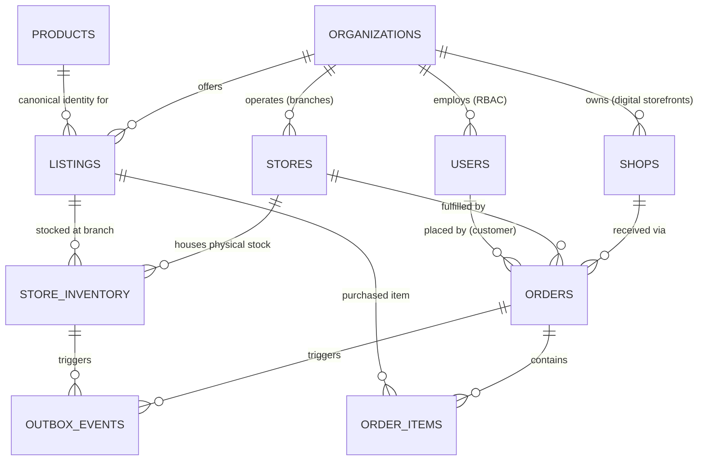

# EVALIPIE — Database Design & Schema Specification

> **Database Engine:** PostgreSQL 15+ (Hosted on Aiven Cloud)  
> **Document Status:** Phase 0 — Design Specification (No migrations executed yet)  
> **Primary Goals:** Absolute ACID Concurrency Control, Multi-Tenant Merchant Isolation, Canonical vs. Listing Decoupling, Transactional Outbox Pattern.

---

## 1. Domain Modeling & Architectural Separation

To satisfy both standalone independent merchants and multi-branch retail chains, the relational schema enforces four clear boundaries:



1. **`organizations` (The Business Entity):** Legal company or merchant (e.g., *Sharma Retailers*, *City Supermarket Corp*). Holds tax info, billing details, and tenant boundary.
2. **`stores` (Physical Branches / Locations):** Physical brick-and-mortar storefronts or regional warehouses (e.g., *Indiranagar Branch*, *Jayanagar Branch*). Stores hold geolocation coordinates, physical addresses, and inventory.
3. **`shops` (The Digital Storefront):** Public-facing brand presentation (e.g., `evalipie.in/shop/sharma-electronics`). Manages banner images, logos, shop description, and theme colors.
4. **`products` (Canonical Global Catalog):** Universal product definitions independent of any seller (e.g., *Sony WH-1000XM5 Headphone*). Maintains global barcodes (EAN/UPC), canonical title, category, and master specs.
5. **`listings` (Merchant Commercial Offer):** A merchant's commercial offering of a canonical product. Contains merchant-specific price (₹), warranty notes, and active status.
6. **`store_inventory` (Physical Stock Record):** The location-specific inventory counter linking a listing to a physical store branch. Protected by transactional row locks.

---

## 2. Complete PostgreSQL DDL Schema

```sql
-- ============================================================================
-- 0. EXTENSIONS & PREREQUISITES
-- ============================================================================
CREATE EXTENSION IF NOT EXISTS "uuid-ossp";
CREATE EXTENSION IF NOT EXISTS "pgcrypto";

-- ============================================================================
-- 1. ORGANIZATIONS (Tenant Root)
-- ============================================================================
CREATE TABLE organizations (
    id UUID PRIMARY KEY DEFAULT uuid_generate_v4(),
    name VARCHAR(255) NOT NULL,
    business_type VARCHAR(50) NOT NULL CHECK (business_type IN ('INDEPENDENT_SHOP', 'RETAIL_CHAIN')),
    tax_identifier VARCHAR(100),
    contact_email VARCHAR(255) NOT NULL,
    contact_phone VARCHAR(50) NOT NULL,
    is_verified BOOLEAN DEFAULT FALSE,
    is_active BOOLEAN DEFAULT TRUE,
    created_at TIMESTAMPTZ DEFAULT NOW(),
    updated_at TIMESTAMPTZ DEFAULT NOW()
);

CREATE INDEX idx_organizations_business_type ON organizations(business_type);

-- ============================================================================
-- 2. USERS & MULTI-TENANT RBAC
-- ============================================================================
CREATE TABLE users (
    id UUID PRIMARY KEY DEFAULT uuid_generate_v4(),
    organization_id UUID REFERENCES organizations(id) ON DELETE SET NULL, -- Nullable for standard customers
    email VARCHAR(255) UNIQUE NOT NULL,
    password_hash VARCHAR(255) NOT NULL,
    full_name VARCHAR(255) NOT NULL,
    phone_number VARCHAR(50),
    role VARCHAR(50) NOT NULL DEFAULT 'CUSTOMER' CHECK (role IN ('CUSTOMER', 'STORE_MANAGER', 'MERCHANT_OWNER', 'SUPER_ADMIN')),
    is_active BOOLEAN DEFAULT TRUE,
    created_at TIMESTAMPTZ DEFAULT NOW(),
    updated_at TIMESTAMPTZ DEFAULT NOW()
);

CREATE INDEX idx_users_org ON users(organization_id);
CREATE INDEX idx_users_email ON users(email);

-- ============================================================================
-- 3. PHYSICAL STORES (Physical Branches)
-- ============================================================================
CREATE TABLE stores (
    id UUID PRIMARY KEY DEFAULT uuid_generate_v4(),
    organization_id UUID NOT NULL REFERENCES organizations(id) ON DELETE CASCADE,
    name VARCHAR(255) NOT NULL, -- e.g., "Indiranagar Branch" or "Main Store"
    store_code VARCHAR(50) NOT NULL, -- e.g., "BLR-IND-01"
    address_line1 TEXT NOT NULL,
    address_line2 TEXT,
    city VARCHAR(100) NOT NULL,
    state VARCHAR(100) NOT NULL,
    postal_code VARCHAR(20) NOT NULL,
    latitude DECIMAL(10, 8),
    longitude DECIMAL(11, 8),
    contact_phone VARCHAR(50),
    manager_id UUID REFERENCES users(id) ON DELETE SET NULL,
    is_active BOOLEAN DEFAULT TRUE,
    created_at TIMESTAMPTZ DEFAULT NOW(),
    updated_at TIMESTAMPTZ DEFAULT NOW(),
    CONSTRAINT uq_org_store_code UNIQUE (organization_id, store_code)
);

CREATE INDEX idx_stores_org ON stores(organization_id);
CREATE INDEX idx_stores_city ON stores(city);

-- ============================================================================
-- 4. DIGITAL SHOPS (Public-Facing Storefronts)
-- ============================================================================
CREATE TABLE shops (
    id UUID PRIMARY KEY DEFAULT uuid_generate_v4(),
    organization_id UUID NOT NULL UNIQUE REFERENCES organizations(id) ON DELETE CASCADE,
    slug VARCHAR(100) UNIQUE NOT NULL, -- e.g., "sharma-electronics" -> evalipie.in/shop/sharma-electronics
    display_name VARCHAR(255) NOT NULL,
    tagline VARCHAR(255),
    description TEXT,
    logo_url TEXT,
    banner_url TEXT,
    primary_color VARCHAR(20) DEFAULT '#167D73',
    rating_avg DECIMAL(3, 2) DEFAULT 5.00,
    rating_count INT DEFAULT 0,
    is_published BOOLEAN DEFAULT TRUE,
    created_at TIMESTAMPTZ DEFAULT NOW(),
    updated_at TIMESTAMPTZ DEFAULT NOW()
);

CREATE INDEX idx_shops_slug ON shops(slug);

-- ============================================================================
-- 5. CANONICAL PRODUCTS (Global Catalog)
-- ============================================================================
CREATE TABLE products (
    id UUID PRIMARY KEY DEFAULT uuid_generate_v4(),
    title VARCHAR(255) NOT NULL,
    brand VARCHAR(100) NOT NULL,
    category VARCHAR(100) NOT NULL,
    sub_category VARCHAR(100),
    upc_ean VARCHAR(100) UNIQUE,
    description TEXT,
    attributes JSONB DEFAULT '{}'::jsonb, -- e.g., {"connectivity": "Bluetooth 5.2", "battery_hours": 30}
    image_url TEXT,
    created_at TIMESTAMPTZ DEFAULT NOW(),
    updated_at TIMESTAMPTZ DEFAULT NOW()
);

CREATE INDEX idx_products_category ON products(category);
CREATE INDEX idx_products_brand ON products(brand);
CREATE INDEX idx_products_attributes ON products USING gin(attributes);

-- ============================================================================
-- 6. MERCHANT LISTINGS (Commercial Offers)
-- ============================================================================
CREATE TABLE listings (
    id UUID PRIMARY KEY DEFAULT uuid_generate_v4(),
    organization_id UUID NOT NULL REFERENCES organizations(id) ON DELETE CASCADE,
    product_id UUID NOT NULL REFERENCES products(id) ON DELETE RESTRICT,
    merchant_sku VARCHAR(100),
    selling_price DECIMAL(12, 2) NOT NULL CHECK (selling_price >= 0),
    original_mrp DECIMAL(12, 2) CHECK (original_mrp >= selling_price),
    condition VARCHAR(50) DEFAULT 'NEW' CHECK (condition IN ('NEW', 'REFURBISHED')),
    is_active BOOLEAN DEFAULT TRUE,
    created_at TIMESTAMPTZ DEFAULT NOW(),
    updated_at TIMESTAMPTZ DEFAULT NOW(),
    CONSTRAINT uq_org_product UNIQUE (organization_id, product_id)
);

CREATE INDEX idx_listings_org ON listings(organization_id);
CREATE INDEX idx_listings_product ON listings(product_id);
CREATE INDEX idx_listings_price ON listings(selling_price);

-- ============================================================================
-- 7. STORE INVENTORY (Physical Stock at Specific Location)
-- ============================================================================
CREATE TABLE store_inventory (
    id UUID PRIMARY KEY DEFAULT uuid_generate_v4(),
    listing_id UUID NOT NULL REFERENCES listings(id) ON DELETE CASCADE,
    store_id UUID NOT NULL REFERENCES stores(id) ON DELETE CASCADE,
    quantity INT NOT NULL DEFAULT 0 CHECK (quantity >= 0),
    reserved_quantity INT NOT NULL DEFAULT 0 CHECK (reserved_quantity >= 0),
    reorder_threshold INT DEFAULT 2,
    updated_at TIMESTAMPTZ DEFAULT NOW(),
    CONSTRAINT uq_listing_store UNIQUE (listing_id, store_id),
    CONSTRAINT chk_stock_integrity CHECK (quantity >= reserved_quantity)
);

CREATE INDEX idx_inventory_listing ON store_inventory(listing_id);
CREATE INDEX idx_inventory_store ON store_inventory(store_id);

-- ============================================================================
-- 8. ORDERS & ORDER ITEMS
-- ============================================================================
CREATE TABLE orders (
    id UUID PRIMARY KEY DEFAULT uuid_generate_v4(),
    order_number VARCHAR(50) UNIQUE NOT NULL, -- e.g., "EVAL-202611-0001"
    customer_id UUID REFERENCES users(id) ON DELETE SET NULL,
    organization_id UUID NOT NULL REFERENCES organizations(id),
    store_id UUID NOT NULL REFERENCES stores(id),
    total_amount DECIMAL(12, 2) NOT NULL,
    currency VARCHAR(10) DEFAULT 'INR',
    status VARCHAR(50) NOT NULL DEFAULT 'PENDING' CHECK (status IN ('PENDING', 'CONFIRMED', 'READY_FOR_PICKUP', 'OUT_FOR_DELIVERY', 'DELIVERED', 'CANCELLED')),
    customer_name VARCHAR(255) NOT NULL,
    customer_phone VARCHAR(50) NOT NULL,
    delivery_address TEXT,
    fulfillment_type VARCHAR(50) NOT NULL DEFAULT 'LOCAL_DELIVERY' CHECK (fulfillment_type IN ('STORE_PICKUP', 'LOCAL_DELIVERY')),
    idempotency_key VARCHAR(255) UNIQUE,
    created_at TIMESTAMPTZ DEFAULT NOW(),
    updated_at TIMESTAMPTZ DEFAULT NOW()
);

CREATE INDEX idx_orders_org ON orders(organization_id);
CREATE INDEX idx_orders_store ON orders(store_id);
CREATE INDEX idx_orders_customer ON orders(customer_id);
CREATE INDEX idx_orders_status ON orders(status);

CREATE TABLE order_items (
    id UUID PRIMARY KEY DEFAULT uuid_generate_v4(),
    order_id UUID NOT NULL REFERENCES orders(id) ON DELETE CASCADE,
    listing_id UUID NOT NULL REFERENCES listings(id),
    product_id UUID NOT NULL REFERENCES products(id),
    unit_price DECIMAL(12, 2) NOT NULL,
    quantity INT NOT NULL CHECK (quantity > 0),
    subtotal DECIMAL(12, 2) NOT NULL,
    created_at TIMESTAMPTZ DEFAULT NOW()
);

CREATE INDEX idx_order_items_order ON order_items(order_id);

-- ============================================================================
-- 9. TRANSACTIONAL OUTBOX (Reliable Kafka Event Streaming)
-- ============================================================================
CREATE TABLE outbox_events (
    id UUID PRIMARY KEY DEFAULT uuid_generate_v4(),
    aggregate_type VARCHAR(50) NOT NULL, -- e.g., 'ORDER', 'INVENTORY', 'LISTING'
    aggregate_id VARCHAR(100) NOT NULL,
    event_type VARCHAR(100) NOT NULL, -- e.g., 'order.placed', 'inventory.changed'
    topic VARCHAR(100) NOT NULL, -- Kafka topic name
    payload JSONB NOT NULL,
    created_at TIMESTAMPTZ DEFAULT NOW(),
    dispatched_at TIMESTAMPTZ,
    retry_count INT DEFAULT 0,
    last_error TEXT
);

CREATE INDEX idx_outbox_pending ON outbox_events(created_at) WHERE dispatched_at IS NULL;

-- ============================================================================
-- 10. CONSUMER DEDUPLICATION & IDEMPOTENCY
-- ============================================================================
CREATE TABLE processed_events (
    event_id UUID PRIMARY KEY,
    consumer_group VARCHAR(100) NOT NULL,
    processed_at TIMESTAMPTZ DEFAULT NOW()
);
```

---

## 3. Concurrency Protection: Stock Reservation Mechanism

To prevent two concurrent buyers from claiming the last item, checkout reservations execute this exact atomic sequence:

```sql
-- 1. Begin atomic transaction
BEGIN;

-- 2. Lock the specific store inventory row. Concurrent requests on this row will block here.
SELECT id, quantity, reserved_quantity
FROM store_inventory
WHERE listing_id = 'e3b0c442-98fc-1c14-9afb-4c8996fb9242'
  AND store_id = '11111111-2222-3333-4444-555555555555'
FOR UPDATE;

-- 3. Application check:
-- IF (quantity - reserved_quantity) >= requested_quantity THEN:
UPDATE store_inventory
SET quantity = quantity - 1,
    updated_at = NOW()
WHERE id = 'inventory-row-id';

-- 4. Create Order & Order Item records in same transaction
INSERT INTO orders (id, order_number, organization_id, store_id, total_amount, status, customer_name, customer_phone)
VALUES ('...', 'EVAL-001', 'org-id', 'store-id', 2499.00, 'CONFIRMED', 'Ananya Sharma', '9876543210');

-- 5. Insert event into transactional outbox
INSERT INTO outbox_events (aggregate_type, aggregate_id, event_type, topic, payload)
VALUES (
    'INVENTORY',
    'inventory-row-id',
    'inventory.changed',
    'evalipie.inventory.changed',
    jsonb_build_object(
        'listing_id', 'e3b0c442-98fc-1c14-9afb-4c8996fb9242',
        'store_id', '11111111-2222-3333-4444-555555555555',
        'new_quantity', 0,
        'timestamp', NOW()
    )
);

-- 6. Commit transaction. Row lock released. Outbox worker immediately picks up the event.
COMMIT;
```
