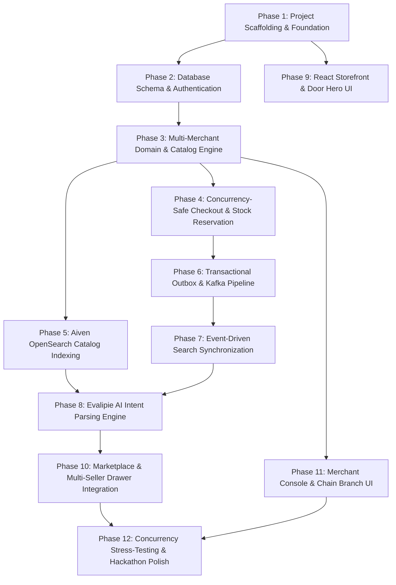

# EVALIPIE — Phased Implementation Roadmap

> **Document Status:** Phase 0 — Engineering Execution Plan  
> **Development Target:** Full-Stack Modular TypeScript Application (React + Node.js/Express + Aiven Cloud)

---

## 1. Roadmap Overview & Dependency Graph

---

## 2. Phase-by-Phase Execution Details

### Phase 1: Project Scaffolding & Environment Setup
* **Objective:** Establish clean, modular TypeScript monorepo/workspace for frontend and backend with shared type definitions.
* **Tasks:**
  1. Scaffold `client/` using Vite + React 18 + TypeScript + Tailwind CSS.
  2. Scaffold `server/` using Node.js + Express + TypeScript (`tsconfig.json` with strict mode).
  3. Define `shared/` directory for TypeScript interfaces (e.g., `Product`, `Listing`, `Order`, `StoreInventory`).
  4. Create comprehensive `.env.example` defining Aiven PostgreSQL, Kafka, OpenSearch, and AI provider configurations.
* **Priority:** **P0** | **Complexity:** Low | **Dependencies:** None
* **Deliverables:** Compiling, linted dual-service repository with simultaneous dev server launch script (`npm run dev`).
* **Acceptance Test:** Both client (`localhost:5173`) and server (`localhost:5000/api/health`) boot cleanly with zero TypeScript errors.

### Phase 2: Database Schema & Authentication Engine
* **Objective:** Establish Aiven PostgreSQL connectivity and execute core DDL tables with tenant-aware JWT authentication.
* **Tasks:**
  1. Initialize `pg` connection pool with SSL certificate support for Aiven PostgreSQL.
  2. Write and execute migration scripts for `organizations`, `stores`, `shops`, `users`, `products`, `listings`, and `store_inventory`.
  3. Implement `/api/v1/auth/register` and `/api/v1/auth/login` with bcrypt password hashing.
  4. Create authentication and tenant context middleware extracting `organization_id` and `store_id`.
* **Priority:** **P0** | **Complexity:** Medium | **Dependencies:** Phase 1
* **Deliverables:** Fully normalized PostgreSQL database running on Aiven; authenticated JWT endpoints.
* **Acceptance Test:** Automated test registers a customer and a merchant; verifies password hashing and role-based token generation.

### Phase 3: Multi-Merchant Domain & Catalog Engine
* **Objective:** Build foundational CRUD operations for canonical products, merchant listings, and store inventory.
* **Tasks:**
  1. Implement canonical product repository (`GET /api/v1/products`, `GET /api/v1/products/:id`).
  2. Implement merchant listing endpoints (`POST /api/v1/merchant/listings`, `GET /api/v1/merchant/listings`).
  3. Implement store inventory updating (`PUT /api/v1/merchant/stores/:storeId/inventory`).
  4. Implement public digital storefront resolver (`GET /api/v1/shops/:slug` and `/api/v1/shops/:slug/listings`).
  5. Seed database with realistic Bengaluru merchant data (Sharma Electronics, Patel Digital, City Supermarket).
* **Priority:** **P0** | **Complexity:** Medium | **Dependencies:** Phase 2
* **Deliverables:** Operational merchant and catalog APIs; seeded demo dataset.
* **Acceptance Test:** Querying `GET /api/v1/shops/sharma-electronics` returns Sharma Electronics' custom profile and active listings.

### Phase 4: Concurrency-Safe Checkout & Stock Reservation
* **Objective:** Guarantee zero overselling using atomic PostgreSQL transactions with row-level locking.
* **Tasks:**
  1. Implement `POST /api/v1/checkout/reserve` wrapping stock check, decrement, order insertion, and outbox write in a single transaction.
  2. Use `SELECT ... FOR UPDATE` on `store_inventory` table to lock target inventory rows.
  3. Enforce check constraint `quantity >= reserved_quantity` at the DB level.
  4. Return `409 Conflict` with alternative available merchants if stock is depleted.
* **Priority:** **P0 (Hackathon Core)** | **Complexity:** High | **Dependencies:** Phase 3
* **Deliverables:** Concurrency-protected order reservation service.
* **Acceptance Test:** Concurrency test fires 10 simultaneous checkout requests for an item with `stock = 1`. Exactly 1 request succeeds with HTTP 201; 9 requests fail with HTTP 409.

### Phase 5: Aiven OpenSearch Catalog Indexing
* **Objective:** Configure Aiven OpenSearch index with edge-ngram analyzers and typo-tolerant search queries.
* **Tasks:**
  1. Establish secure OpenSearch client using Aiven HTTPS credentials.
  2. Create index `evalipie_catalog` with custom n-gram analyzer and English stemmer.
  3. Write bulk indexing script to populate OpenSearch from PostgreSQL canonical products and merchant listings.
  4. Implement `GET /api/v1/search` supporting fuzzy search (`fuzziness: "AUTO"`), category filtering, and city filtering.
* **Priority:** **P0 (Hackathon Core)** | **Complexity:** Medium | **Dependencies:** Phase 3
* **Deliverables:** High-performance typo-tolerant search endpoint.
* **Acceptance Test:** Querying `/api/v1/search?q=blutooth hedphone` successfully returns Bluetooth Wireless Headphones with latency < 50ms.

### Phase 6: Transactional Outbox & Aiven Kafka Pipeline
* **Objective:** Build reliable, asynchronous event streaming from PostgreSQL to Aiven Apache Kafka.
* **Tasks:**
  1. Create `outbox_events` table in PostgreSQL.
  2. Create Kafka topics: `evalipie.order.placed`, `evalipie.inventory.changed`, `evalipie.listing.updated`.
  3. Implement Outbox Relay Worker (polling unsent events using `SELECT ... FOR UPDATE SKIP LOCKED` every 250ms).
  4. Implement Kafka producer publishing events with partition keys.
* **Priority:** **P0 (Hackathon Core)** | **Complexity:** High | **Dependencies:** Phase 4
* **Deliverables:** Resilient event publisher decoupling orders from downstream consumers.
* **Acceptance Test:** Triggering a checkout writes to `outbox_events`; worker publishes event to Kafka and marks row as dispatched.

### Phase 7: Event-Driven Search Index Synchronization
* **Objective:** Consume Kafka events and update OpenSearch index asynchronously in real time.
* **Tasks:**
  1. Implement Kafka consumer listening to `evalipie.inventory.changed`.
  2. Consumer parses payload and executes atomic partial update on OpenSearch document.
  3. Implement consumer idempotency table `processed_events` to prevent duplicate updates.
* **Priority:** **P0 (Hackathon Core)** | **Complexity:** Medium | **Dependencies:** Phase 5, Phase 6
* **Deliverables:** Real-time search index synchronizer.
* **Acceptance Test:** Stock reserved in Postgres is reflected in OpenSearch search results within < 500ms.

### Phase 8: Evalipie AI Intent Parsing Engine
* **Objective:** Convert natural language shopper requests into structured OpenSearch search filters without hallucinations.
* **Tasks:**
  1. Implement LLM semantic parser calling Gemini/OpenAI API with strict JSON schema constraints.
  2. Implement robust fallback heuristic regex/dictionary parser for offline/unconfigured mode.
  3. Implement `/api/v1/ai/discover` executing intent extraction -> OpenSearch query -> Postgres live validation.
  4. Implement grounded explanation generator matching user requirements to product attributes.
* **Priority:** **P0 (Signature Feature)** | **Complexity:** High | **Dependencies:** Phase 5, Phase 7
* **Deliverables:** Hallucination-free conversational product discovery pipeline.
* **Acceptance Test:** Submitting *"clear audio meetings under ₹3,000"* returns USB Condenser Mic and Bluetooth Headset with explanation pill.

### Phase 9: React Storefront & Door Hero UI
* **Objective:** Port and refine the HTML prototype into high-fidelity, responsive React components.
* **Tasks:**
  1. Build `DoorHero` component with optimized 3D CSS perspective transforms and scroll interpolation.
  2. Add "Skip to Marketplace" and touch-friendly controls.
  3. Build responsive Header with city selector, search toggle, and cart counter.
  4. Build Category Grid and "Trending in Bengaluru" feeds.
* **Priority:** **P0** | **Complexity:** Medium | **Dependencies:** Phase 1
* **Deliverables:** Engaging, visually stunning marketplace landing page.
* **Acceptance Test:** Smooth 60fps door opening animation on desktop; responsive fallback on mobile.

### Phase 10: Marketplace & Multi-Seller Drawer Integration
* **Objective:** Connect React frontend to real backend APIs, AI discovery, and multi-seller comparison drawer.
* **Tasks:**
  1. Connect `AiSearchBar` to `POST /api/v1/ai/discover` with interactive chips.
  2. Implement `SellerComparisonDrawer` allowing users to view and compare multiple shopkeepers selling the same item.
  3. Implement slide-over Cart and single-merchant Checkout modal with atomic reservation.
  4. Connect dedicated shop pages `/shop/:slug`.
* **Priority:** **P0** | **Complexity:** Medium | **Dependencies:** Phase 8, Phase 9
* **Deliverables:** Fully interactive end-to-end customer shopping experience.
* **Acceptance Test:** User searches via AI, opens comparison drawer, selects Sharma Electronics, and checks out successfully.

### Phase 11: Merchant Console & Chain Branch UI
* **Objective:** Build dedicated portals for independent shopkeepers and retail chain managers.
* **Tasks:**
  1. Build Merchant Dashboard with real-time incoming order notifications.
  2. Build Listing Manager and Stock Stepper (+/- stock adjuster).
  3. Build Branch Switcher for multi-branch retail chains (e.g. City Supermarket).
* **Priority:** **P1** | **Complexity:** Medium | **Dependencies:** Phase 3, Phase 10
* **Deliverables:** Functional merchant management web console.
* **Acceptance Test:** Merchant updates stock from 5 to 0; change is immediately visible on the customer marketplace.

### Phase 12: Stress-Testing, Concurrency Proof & Hackathon Polish
* **Objective:** Execute live concurrency simulation and prepare flawless demo script.
* **Tasks:**
  1. Build automated concurrency test script (`scripts/test-concurrency.ts`) executing simultaneous checkouts.
  2. Create Admin Dashboard view displaying Outbox events, Kafka topics, and OpenSearch sync latency.
  3. Polish loading states, toasts, and error boundaries.
* **Priority:** **P0** | **Complexity:** Low | **Dependencies:** All previous phases
* **Deliverables:** Production-grade system with verified concurrency resistance and demo telemetry.
* **Acceptance Test:** Live demo demonstrates 2 browsers competing for 1 item; one succeeds, one gets graceful 409 conflict.
