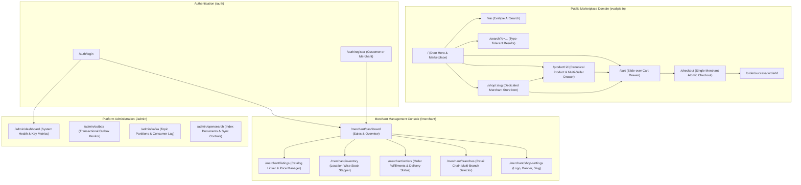
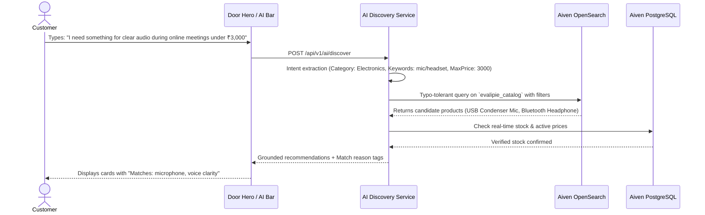

# EVALIPIE — User Flows & Screen Map

> **Document Status:** Phase 0 — Design Specification  
> **Personas Covered:** Customer (Shopper), Independent Shopkeeper, Retail Chain Operator, Platform Administrator.

---

## 1. Application Screen Map & Route Hierarchy



---

## 2. Customer User Flows

### Flow 1: Natural Language Discovery (Evalipie AI)



### Flow 2: Multi-Seller Canonical Price Comparison

```mermaid
sequenceDiagram
    actor User as Customer
    participant UI as Product Details Page
    participant API as Catalog API
    participant PG as PostgreSQL

    User->>UI: Clicks "Bluetooth Wireless Headphones"
    UI->>API: GET /api/v1/products/prod-101/sellers?city=Bengaluru
    API->>PG: SELECT * FROM listings l JOIN stores s ON l.id = ... WHERE product_id = 'prod-101'
    PG-->>API: 2 Sellers found (Sharma Electronics ₹2,499 [In Stock], Patel Digital ₹2,699 [Low Stock])
    API-->>UI: Seller comparison payload
    UI-->>User: Renders comparative drawer; User selects "Sharma Electronics" (Lowest Price, 1.4km away)
    User->>UI: Clicks "Add to Cart"
```

### Flow 3: Concurrency-Safe Checkout

```mermaid
sequenceDiagram
    actor BuyerA as Buyer A (Phone)
    actor BuyerB as Buyer B (Laptop)
    participant API as Order API
    participant PG as PostgreSQL (Aiven)

    Note over BuyerA,BuyerB: Both attempt to purchase the ONLY remaining unit in stock
    par Concurrent Requests
        BuyerA->>API: POST /checkout/reserve (Qty: 1)
        BuyerB->>API: POST /checkout/reserve (Qty: 1)
    end
    API->>PG: BEGIN Tx (Buyer A) -> SELECT ... FOR UPDATE (Row Locked)
    API->>PG: BEGIN Tx (Buyer B) -> Waits for lock on same row...
    Note over PG: Buyer A transaction completes: Stock decremented (1 -> 0), Outbox event created
    API->>PG: COMMIT (Buyer A)
    API-->>BuyerA: 201 Created (Order Confirmed: EVAL-001)
    
    Note over PG: Buyer B lock acquires; evaluates: quantity (0) < requested (1)
    API->>PG: ROLLBACK (Buyer B)
    API-->>BuyerB: 409 Conflict ("Last item claimed by another buyer. See other sellers")
```

---

## 3. Independent Merchant User Flows

### Flow 1: 5-Minute Onboarding & Storefront Launch

1. **Sign Up:** Merchant visits `evalipie.in/#sell` -> enters business name *"Sharma Electronics"*, email, and phone.
2. **Slug Reservation:** System validates and locks unique slug: `evalipie.in/shop/sharma-electronics`.
3. **Branding Setup:** Merchant uploads logo, storefront photo, and adds street address (*100ft Road, Indiranagar, Bengaluru*).
4. **Link First Listing:**
   - Searches master catalog for *"Bluetooth Wireless Headphones"*.
   - Canonical item found -> Clicks "Offer this Product".
   - Enters Selling Price: `₹2,499` (MRP: `₹3,299`).
   - Enters Shelf Quantity: `8 units`.
   - Clicks "Publish Listing".
5. **Live Verification:** Merchant visits `evalipie.in/shop/sharma-electronics`; verifies their live store is discoverable across Bengaluru.

### Flow 2: Real-Time Order Fulfillment

1. Merchant console displays desktop audio ping and toast: *"New Order #EVAL-202611-0001 (₹2,499) for Sharma Electronics"*.
2. Merchant reviews item, packs the physical unit from shelf, and clicks **"Confirm Order"**.
3. Status moves from `PENDING` -> `READY_FOR_PICKUP`.
4. Delivery partner or customer arrives -> Merchant verifies order OTP -> clicks **"Mark Fulfilled"**.

---

## 4. Retail Chain User Flows (Multi-Branch Management)

### Flow: Central Catalog + Multi-Store Branch Allocation

1. **Organization Creation:** Operations VP registers *City Supermarket Retail Chain*.
2. **Branch Creation:**
   - Branch 1: *Indiranagar Branch* (Manager: Rajesh, Code: `BLR-IND`).
   - Branch 2: *Jayanagar Branch* (Manager: Sneha, Code: `BLR-JAY`).
   - Branch 3: *Whitefield Branch* (Manager: Amit, Code: `BLR-WHI`).
3. **Inventory Matrix:**
   - Operations Director loads the central catalog.
   - For item *"Compact Air Fryer"*:
     - Sets Indiranagar stock: `5 units`.
     - Sets Jayanagar stock: `0 units` (Out of stock).
     - Sets Whitefield stock: `3 units`.
4. **Customer Geolocation Routing:**
   - A customer browsing from Jayanagar sees *"Air Fryer — Out of stock at Jayanagar branch"*, with instant suggestion *"Available for pickup at Indiranagar (4.2 km)"*.
5. **Chain Analytics:** VP views combined revenue across all 3 branches, comparative sell-through rates, and low-stock alerts on a single unified screen.

---

## 5. Platform Admin User Flows

1. **Cluster Operations:** Platform admin logs into `/admin` -> verifies active status for Aiven PostgreSQL, Aiven Kafka, and Aiven OpenSearch.
2. **Transactional Outbox Monitoring:** Inspects `outbox_events` table metrics:
   - Total events published today.
   - Pending events queue depth (target: `< 5`).
   - Failed events with retry logs.
3. **OpenSearch Health & Sync:**
   - Views indexed document count (`evalipie_catalog`).
   - One-click trigger for complete re-synchronization from PostgreSQL in case of mapping changes.
