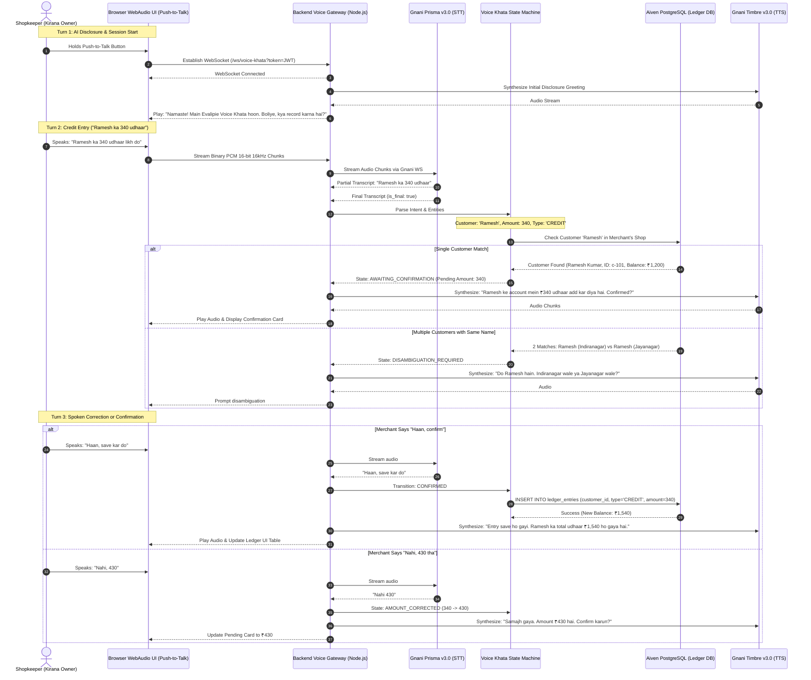

# EVALIPIE VOICE KHATA — Technical Design & Gnani Voice Architecture

> **Official Competition Track:** Gnani Voice Hackathon — PS2 (Voice Khata for Kirana Stores)  
> **Brand / Product:** Evalipie Voice Khata (`evalipie.in/business/voice-khata`)  
> **Tagline:** *"Your Digital Khata. Just Use Your Voice."*  
> **Speech Stack:** Gnani API Platform (Prisma v3.0 STT + Timbre v3.0 TTS over WebSockets) + Custom Orchestration State Machine

---

## 1. Executive Summary & Problem Context

Kirana store owners and local neighborhood shopkeepers operate in high-tempo, noisy, and tactile environments. While attending to customers across the counter, weighing grain, packing spices, or bagging vegetables, shopkeepers cannot stop to open a mobile app, navigate form fields, and type numbers. Consequently, traditional shopkeepers either rely on loose paper notebooks (*bahi-khata*) prone to loss, damage, and calculation errors, or fail to record credit altogether.

**Evalipie Voice Khata** provides an hands-free, voice-first digital ledger allowing shopkeepers to record credit (*udhaar*), log received payments, correct mistakes conversationally, disambiguate identical customer names, and query balances—in natural Hinglish and Indic code-mixing—while continuing to serve customers.

---

## 2. Gnani API Platform Hard Constraints & Compliance

The implementation strictly satisfies all constraints stipulated in the official Gnani Voice Hackathon PS2 brief:

| Parameter | Constraint | Evalipie Implementation |
| :--- | :--- | :--- |
| **Speech-to-Text (STT)** | Gnani Prisma v3.0 | Real-time streaming WebSocket client feeding PCM 16kHz audio to Gnani Prisma. |
| **Text-to-Speech (TTS)** | Gnani Timbre v3.0 | Low-latency audio synthesis stream rendering natural Indic spoken audio feedback. |
| **Streaming Protocol** | WebSocket Streaming Only | Full-duplex WebSocket session between browser, backend, and Gnani API gateway. |
| **Agent Loop** | Custom Orchestration Only | Proprietary state machine (no hosted black-box telephony / Vapi / Retell allowed). |
| **Telephony / Calling** | Prohibited (No Phone Calls) | Pure in-browser WebAudio capture via tactile Push-to-Talk; zero telephony integration. |
| **Voice Cloning** | Prohibited | Uses standard pre-trained Gnani Timbre neural voices; zero voice cloning. |
| **AI Disclosure** | Mandatory in Turn 1 | First prompt turn begins with: *"Namaste! Main Evalipie ka AI Voice Khata Assistant hoon..."* |
| **Privacy & Retention** | Ephemeral Processing | Audio and transcripts are processed in memory; no sensitive transcripts published to Kafka. |

---

## 3. End-to-End Voice Architecture Pipeline



---

## 4. Voice Khata Database Schema Specification

The ledger uses an append-only accounting architecture ensuring every transaction is completely traceable and isolated by merchant organization:

```sql
-- 1. LEDGER CUSTOMERS (Belong to a specific shop/organization)
CREATE TABLE ledger_customers (
    id UUID PRIMARY KEY DEFAULT uuid_generate_v4(),
    organization_id UUID NOT NULL REFERENCES organizations(id) ON DELETE CASCADE,
    name VARCHAR(255) NOT NULL,
    phone VARCHAR(50),
    disambiguation_tag VARCHAR(100), -- e.g., "Indiranagar", "Kirana regular", "Shop near temple"
    current_balance DECIMAL(12, 2) NOT NULL DEFAULT 0.00, -- Positive = Customer owes merchant (Udhaar)
    is_active BOOLEAN DEFAULT TRUE,
    created_at TIMESTAMPTZ DEFAULT NOW(),
    updated_at TIMESTAMPTZ DEFAULT NOW()
);

CREATE INDEX idx_ledger_cust_org ON ledger_customers(organization_id);
CREATE INDEX idx_ledger_cust_name ON ledger_customers(name);

-- 2. LEDGER ENTRIES (Append-only Financial Log)
CREATE TABLE ledger_entries (
    id UUID PRIMARY KEY DEFAULT uuid_generate_v4(),
    organization_id UUID NOT NULL REFERENCES organizations(id) ON DELETE CASCADE,
    customer_id UUID NOT NULL REFERENCES ledger_customers(id) ON DELETE RESTRICT,
    entry_type VARCHAR(20) NOT NULL CHECK (entry_type IN ('CREDIT', 'PAYMENT', 'ADJUSTMENT')),
    amount DECIMAL(12, 2) NOT NULL CHECK (amount > 0),
    balance_after DECIMAL(12, 2) NOT NULL,
    notes TEXT,
    voice_session_id UUID,
    recorded_by UUID REFERENCES users(id),
    created_at TIMESTAMPTZ DEFAULT NOW()
);

CREATE INDEX idx_ledger_entries_org ON ledger_entries(organization_id);
CREATE INDEX idx_ledger_entries_customer ON ledger_entries(customer_id);
CREATE INDEX idx_ledger_entries_date ON ledger_entries(created_at);

-- 3. AUDITABLE CORRECTIONS TABLE
CREATE TABLE ledger_entry_corrections (
    id UUID PRIMARY KEY DEFAULT uuid_generate_v4(),
    original_entry_id UUID NOT NULL REFERENCES ledger_entries(id),
    corrected_amount DECIMAL(12, 2) NOT NULL,
    reason TEXT NOT NULL,
    corrected_by UUID REFERENCES users(id),
    created_at TIMESTAMPTZ DEFAULT NOW()
);

-- 4. VOICE SESSIONS (Latency & Health Monitoring)
CREATE TABLE voice_sessions (
    id UUID PRIMARY KEY DEFAULT uuid_generate_v4(),
    organization_id UUID NOT NULL REFERENCES organizations(id),
    session_start TIMESTAMPTZ DEFAULT NOW(),
    session_end TIMESTAMPTZ,
    turns_count INT DEFAULT 0,
    average_latency_ms INT,
    gnani_stt_status VARCHAR(50) DEFAULT 'ACTIVE',
    gnani_tts_status VARCHAR(50) DEFAULT 'ACTIVE'
);
```

---

## 5. Conversational Intent & Number Parsing Grammar

The NLU engine supports natural Hinglish and colloquial number variations commonly spoken in Indian retail:

```
[Customer Name] + [Amount] + ["udhaar" / "jama" / "diye"]
```

### Number Conversion Table
* `"sau"` $\rightarrow 100$
* `"chaalis"` $\rightarrow 40$
* `"teen sau chaalis"` $\rightarrow 340$
* `"barah sau pachaas"` $\rightarrow 1250$
* `"dedh sau"` $\rightarrow 150$
* `"dhai sau"` $\rightarrow 250$
* `"hazaar"` $\rightarrow 1000$

### Supported Transaction Direction Intents
* **Credit (Udhaar):** `"udhaar likh do"`, `"baaki hai"`, `"le gaya"`, `"khate mein daalo"`, `"likho"`.
* **Payment (Jama):** `"jama kar do"`, `"diya"`, `"diye"`, `"payment aaya"`, `"paise diye"`, `"chuka diya"`.
* **Balance Query:** `"kitna baaki hai"`, `"total kitna hai"`, `"hisab batao"`, `"aaj kitna udhaar gaya"`.
